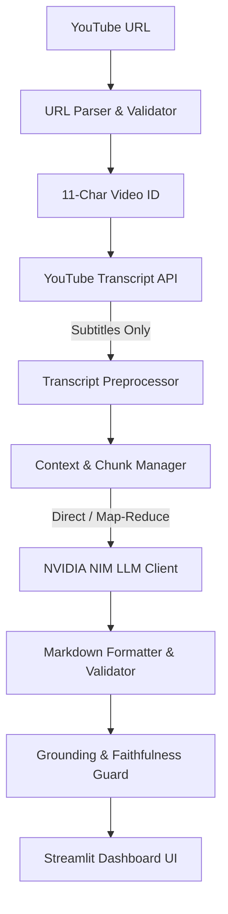

# YouTube Video Summarizer & Notes Extractor

> **Zero-download Generative AI summarization of YouTube educational content using NVIDIA NIM (`meta/llama-3.1-70b-instruct`) and Streamlit.**

---

## 🌟 Architectural Overview

This system extracts structured study notes from YouTube videos **without downloading any audio or video streams**. It maintains an invariant zero-download footprint by communicating directly with YouTube's caption infrastructure, preprocessing subtitles, managing context limits through intelligent chunking, and synthesizing grounded notes via NVIDIA NIM microservices.



---

## 🚀 Key Features & Design Invariants

- **Strict Zero-Download Architecture**: No `yt-dlp`, no FFmpeg, and no temporary `.mp4`/`.mp3` files. Transcripts are fetched purely as text via `youtube-transcript-api`.
- **Intelligent Preprocessing**: Cleans HTML entities, NFKC unicode, strips audio cues (`[Music]`, `[Applause]`, `♪`), corrects punctuation spacing, and merges fragmented caption lines while preserving technical jargon and mathematical formulas.
- **Context-Aware Sentence Chunking**: Respects sentence/paragraph boundaries with sliding sentence overlap, avoiding mid-word or mid-sentence cuts.
- **Hierarchical Map-Reduce**: Automatically switches between single-pass summarization (for short/medium videos) and chunk-level map-reduce (for multi-hour lectures).
- **Strict Grounding Guardrails**: Prompts explicitly forbid hallucination, invention of facts, or external knowledge insertion.
- **Automated Faithfulness Validation**: Module 12 checks numerical claims, verifies terminology retention, audits output structure, and flags unsupported statements.
- **Benchmarking & Telemetry**: Module 13 tracks multi-stage latency (URL parsing, retrieval, preprocessing, chunking, LLM generation), compression ratio, and pure-Python ROUGE-1/2/L calculation.

---

## 📦 System Modules (1 to 15)

| Module | File | Purpose |
| :--- | :--- | :--- |
| **M1: URL Parsing** | [`modules/url_parser.py`](modules/url_parser.py) | Validates standard, shortened (`youtu.be`), embed, shorts, and query-param URLs. |
| **M2: Subtitle Retrieval** | [`modules/transcript.py`](modules/transcript.py) | `TranscriptProvider` abstraction retrieving manual/auto English transcripts without downloads. |
| **M3: Preprocessing** | [`modules/preprocessing.py`](modules/preprocessing.py) | Normalization, artifact removal, fragment stitching, and transcript metrics. |
| **M4: Chunking** | [`modules/chunking.py`](modules/chunking.py) | Sentence-boundary-aware chunker with configurable size and overlap. |
| **M5: NVIDIA NIM Client** | [`modules/llm.py`](modules/llm.py) | Robust OpenAI SDK wrapper for NVIDIA NIM with rate-limit and auth error mapping. |
| **M6: Prompt Engineering** | [`prompts/`](prompts/) | Strictly grounded prompts enforcing Executive Summary, Key Concepts, and Action Items. |
| **M7: Summarizer Engine** | [`modules/summarizer.py`](modules/summarizer.py) | Direct and Map-Reduce summarization pipelines. |
| **M8: Markdown Formatter** | [`modules/formatter.py`](modules/formatter.py) | Renders clean Markdown and validates required structural sections. |
| **M9: Streamlit UI** | [`app.py`](app.py) | Interactive dashboard with real-time stage progress and download exports. |
| **M10: Whisper Fallback** | [`modules/transcript.py`](modules/transcript.py) | Provider stub for user-supplied local audio (rejects automated web downloading). |
| **M11: Error Handling** | [`modules/exceptions.py`](modules/exceptions.py), [`utils/error_handler.py`](utils/error_handler.py) | Centralized error hierarchy covering all 16 pipeline failure modes. |
| **M12: Grounding Validation** | [`modules/validation.py`](modules/validation.py) | Heuristic and optional LLM-based faithfulness and hallucination auditing. |
| **M13: Benchmarking** | [`evaluation/metrics.py`](evaluation/metrics.py), [`evaluation/benchmark.py`](evaluation/benchmark.py) | Latency tracking, compression ratios, ROUGE evaluation, and CSV telemetry. |
| **M14: 25-Video Benchmark** | [`evaluation/test_dataset.csv`](evaluation/test_dataset.csv), [`evaluation/results.csv`](evaluation/results.csv) | Multi-video automated benchmarking, results logging, and aggregate telemetry reporting. |
| **M15: Human Evaluation** | [`evaluation/human_evaluation_template.csv`](evaluation/human_evaluation_template.csv), [`evaluation/human_eval.py`](evaluation/human_eval.py) | 1-5 scale rubric evaluation for completeness, scannability, and fact verification. |

---


## 🛠️ Installation & Setup

### 1. Prerequisites
- Python 3.10+ (Tested on Python 3.13)
- An NVIDIA NGC API Key with access to NVIDIA NIM endpoints (e.g., `meta/llama-3.1-70b-instruct`)

### 2. Clone and Setup Virtual Environment
```bash
# Clone the repository
git clone <repo-url>
cd GenAi_YT

# Create virtual environment
python -m venv venv

# Activate virtual environment
# Windows PowerShell:
.\venv\Scripts\Activate.ps1
# Linux / macOS:
# source venv/bin/activate

# Install dependencies
pip install -r requirements.txt
```

### 3. Configure Environment Variables
Copy `.env.example` to `.env` and fill in your NVIDIA API key:
```bash
cp .env.example .env
```

Edit `.env`:
```ini
NVIDIA_API_KEY=nvapi-your-key-here
NVIDIA_BASE_URL=https://integrate.api.nvidia.com/v1
NVIDIA_MODEL=meta/llama-3.1-70b-instruct
DEFAULT_CHUNK_SIZE_WORDS=800
DEFAULT_CHUNK_OVERLAP_WORDS=100
MAX_TRANSCRIPT_WORDS=50000
LLM_TIMEOUT_SECONDS=60.0
LLM_MAX_RETRIES=3
DEFAULT_TEMPERATURE=0.2
DEFAULT_MAX_TOKENS=2048
```

---

## 💻 Running the Application

Launch the Streamlit web dashboard:
```bash
streamlit run app.py
```
Open `http://localhost:8501` in your browser.

### Using the App:
1. Paste any YouTube URL (standard watch, shortened `youtu.be`, or embed).
2. Click **Generate Notes**.
3. Watch the real-time stage progress indicators:
   - `✓ URL validated`
   - `✓ Video ID extracted`
   - `✓ Transcript retrieved`
   - `✓ Transcript cleaned`
   - `✓ Transcript prepared`
   - `✓ AI summarization in progress`
   - `✓ Notes generated`
4. Inspect the generated notes formatted into:
   - **# Executive Summary**
   - **# Key Concepts**
   - **# Action Items**
5. Download notes in `.md` or `.txt` format.

---

## 🧪 Running the Test Suite

The project includes an automated test suite covering all modules:
```bash
python -m unittest discover tests -v
```

All 75 unit tests run in less than 0.15s and test:
- URL regex edge cases and parameter stripping
- YouTube API mocking and exception classification
- Subtitle cleanup, unicode normalization, and fragment merging
- Sentence chunking and overlap verification
- NVIDIA NIM client error mapping and retry handling
- Map-reduce and direct summarizer routing
- Markdown structure validation
- Secret sanitization and error masking
- Grounding and faithfulness checks
- Multi-stage latency profiling and ROUGE metrics
- 25-video dataset parsing, results.csv recording, and aggregate evaluation reporting

---

## 📊 Evaluation & Benchmarking (Modules 13 & 14)

The framework includes a dataset of 25 educational videos across STEM domains in [`evaluation/test_dataset.csv`](evaluation/test_dataset.csv).

To run benchmarks while keeping API usage controlled:
```bash
# Process only the first N videos to control API quota
python -m evaluation.benchmark --limit 3

# Benchmark a single video ID
python -m evaluation.benchmark --video-id aircAruvnKk

# Run full dataset and save markdown evaluation report
python -m evaluation.benchmark --report-out evaluation/report.md
```

Empirical results are logged to [`evaluation/results.csv`](evaluation/results.csv) without fabricating any missing values:
```csv
video_id,youtube_url,domain,approx_duration,status,transcript_words,summary_words,compression_ratio,chunk_count,llm_calls,total_latency_seconds,retrieval_latency,preprocessing_latency,chunking_latency,llm_latency,rouge1_f1,rouge2_f1,rougel_f1,error,notes
```

The runner automatically compiles an aggregate evaluation report containing:
- Total videos
- Successful & failed counts
- Success rate (%)
- Average & median latency (seconds)
- Average compression ratio
- Average summary length (words)
- Average chunk count

### Human Evaluation Framework (Module 15)

Human qualitative evaluation is recorded in [`evaluation/human_evaluation_template.csv`](evaluation/human_evaluation_template.csv) on a 1-5 rubric scale across three dimensions:
- **Completeness (1-5)**: Preservation of formulas, mechanisms, concepts, and technical terminology.
- **Scannability (1-5)**: Visual structure across Executive Summary, Key Concepts, and Action Items.
- **Fact Verification (1-5)**: Verifiability of claims directly against the source video/transcript.

Calculate aggregate and per-video metrics:
```bash
python -m evaluation.human_eval --file evaluation/human_evaluation_template.csv
```

Outputs average completeness, scannability, fact verification, and per-video score breakdowns. No evaluator responses are fabricated.

---


## 🔒 Security & Safety Guarantees

- **No Secrets in Output**: NVIDIA API keys are automatically scrubbed from logs, errors, and traces (`sanitize_secrets`).
- **No Hallucinated Benchmarks**: ROUGE metrics are only computed when a genuine human reference summary is supplied.
- **Fail-Safe Captions**: If a video lacks English captions, the system cleanly informs the user rather than falling back to risky unauthorized scrapers.
